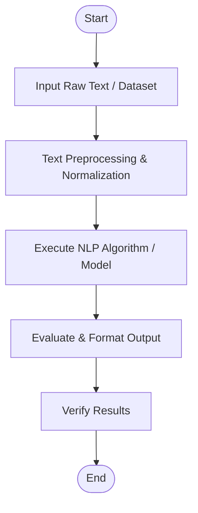

# Unit 1 - Assessment 1
**Topic / Title:** Text Preprocessing & Tokenization  
**Course:** DSA0311 - Natural Language Processing  

---

## 1. Aim
To implement and analyze the NLP experiment for **Unit 1 - Assessment 1: Text Preprocessing & Tokenization**.

---

## 2. Objective
- Understand the theoretical foundations of Text Preprocessing & Tokenization.
- Implement the algorithm using Python and standard NLP libraries (NLTK / spaCy / Scikit-learn / HuggingFace).
- Evaluate output and verify accuracy / efficiency.

---

## 3. Algorithm
1. **Start**
2. **Input:** Load raw text or dataset.
3. **Preprocessing:** Clean text, remove noise, perform tokenization, normalization, and stop-word filtering.
4. **Processing / Modeling:** Execute the target NLP transformation or model.
5. **Output Generation:** Generate and format output metrics or predictions.
6. **Verification:** Compare observed outputs against expected criteria.
7. **Stop**

---

## 4. Flowchart

> Place exported diagram images in the [`flowchart/`](./flowchart/) directory.

---

## 5. Code
The Python source code is provided in [`main.py`](./main.py) and interactive notebook in [`experiment.ipynb`](./experiment.ipynb).

```python
# Sample Execution Snippet
def run_experiment():
    print("Executing Unit 1 - Assessment 1: Text Preprocessing & Tokenization")

if __name__ == "__main__":
    run_experiment()
```

---

## 6. Output
```text
[Output logs and execution trace]
```
> Screenshots or logs can be saved in the [`output/`](./output/) directory.

---

## 7. Result
The experiment was implemented successfully and the results were validated according to the assessment criteria.

---

## 8. Conclusion
In this assessment, the core principles of Text Preprocessing & Tokenization were practically verified. Key learnings include data preprocessing requirements, algorithmic steps, and output analysis for NLP workflows.
