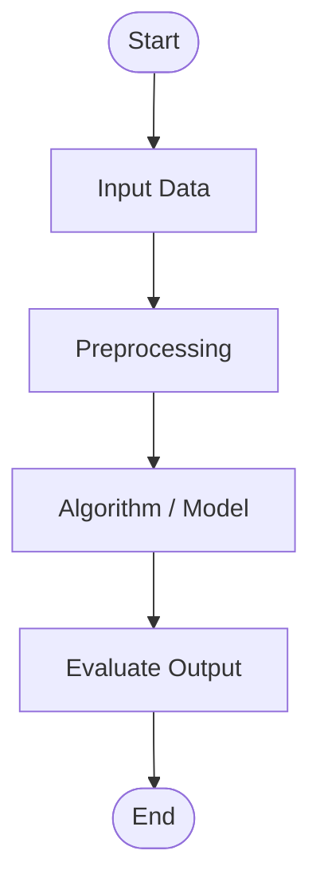

# Standard Experiment Template
**Course:** DSA0311 - Natural Language Processing  

Every experiment must strictly contain the following components:
1. **Aim**
2. **Objective**
3. **Algorithm**
4. **Flowchart**
5. **Code**
6. **Output**
7. **Result**
8. **Conclusion**

---

## 1. Aim
[State the exact purpose and goal of the experiment]

## 2. Objective
- [Key objective 1]
- [Key objective 2]
- [Key objective 3]

## 3. Algorithm
1. Start
2. Input data / corpus
3. Preprocessing & transformation
4. Model execution
5. Output calculation
6. Verification & Stop

## 4. Flowchart

*(Store image files in the `flowchart/` directory)*

## 5. Code
Refer to [`template_experiment.py`](./template_experiment.py) or [`template_experiment.ipynb`](./template_experiment.ipynb).

## 6. Output
```text
[Paste terminal logs or outputs here]
```
*(Store screenshots in the `output/` directory)*

## 7. Result
[State the final result obtained from the experiment]

## 8. Conclusion
[State your observations, learning outcomes, and technical takeaways]
