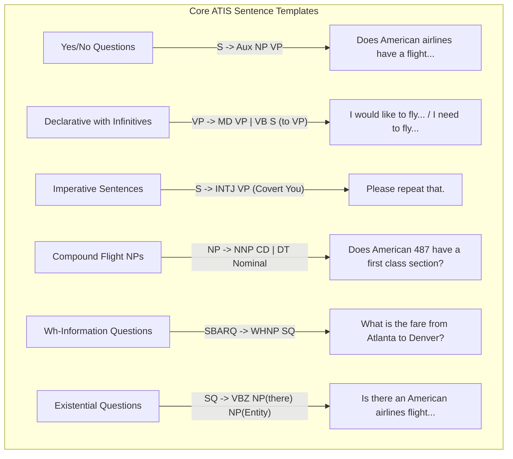
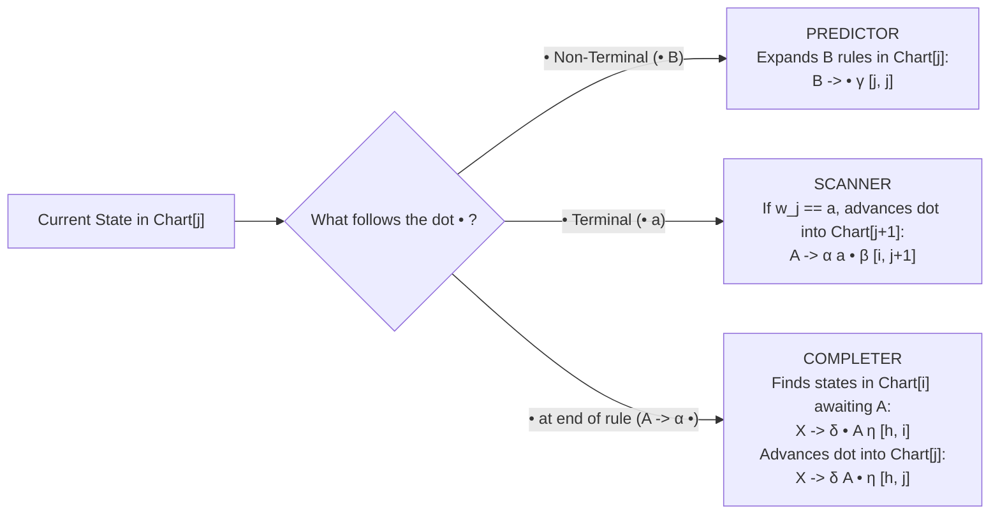

# Natural Language Processing (DSA0311) — Comprehensive Exam Revision Notes

> **Course**: DSA0311 / DSA03 — Natural Language Processing  
> **Target Audience**: B.Tech CSE (Year: 2026) | SIMATS School of Engineering  
> **Purpose**: High-yield conceptual revision, assignment solution summaries, and step-by-step algorithmic guides for written semester exams and vivas.

---

## Table of Contents
1. [Course Overview & Unit Mapping](#1-course-overview--unit-mapping)
2. [Assignment 1 Revision Notes: Automata & Minimum Edit Distance](#2-assignment-1-revision-notes-automata--minimum-edit-distance)
   - 2.1 Regular Expressions & Finite State Automata (FSA / DFA)
   - 2.2 Minimum Edit Distance (Levenshtein Dynamic Programming)
3. [Assignment 2 Revision Notes: N-Grams, Smoothing & POS Tagging](#3-assignment-2-revision-notes-n-grams-smoothing--pos-tagging)
   - 3.1 N-Gram Language Modeling & Maximum Likelihood Estimation
   - 3.2 Laplace (Add-1) Smoothing & Effective Count Discounting
   - 3.3 Bag Generation & TSP Hardness
   - 3.4 Penn Treebank POS Tagging & Tricky Disambiguations
4. [Assignment 3 In-Depth Exam Guide: CFGs, ATIS Trees & Earley Parsing](#4-assignment-3-in-depth-exam-guide-cfgs-atis-trees--earley-parsing)
   - 4.1 Context-Free Grammars (CFGs) & Structural Ambiguity
   - 4.2 ATIS Domain Syntactic Patterns (7 Core Sentence Structures)
   - 4.3 Earley Parsing Masterclass: Algorithm, Mechanics & Proofs
   - 4.4 Step-by-Step Earley Trace: *"Christ Opened the eyes"*
   - 4.5 Exam Cheat-Sheet & Common Pitfalls to Avoid
5. [Assignment 4 In-Depth Exam Guide: First-Order Logic, Inference & Temporal Semantics](#5-assignment-4-in-depth-exam-guide-first-order-logic-inference--temporal-semantics)
   - 5.1 First-Order Logic Translations & Quantifier Scope Duality
   - 5.2 Knowledge Base Formulation & Natural Deduction Proofs
   - 5.3 Automated Theorem Proving via Resolution Refutation
   - 5.4 Reichenbach Tense Logic & Allen's Interval Algebra
   - 5.5 Ontological Design: Definitional Biconditionals vs. Material Implication
6. [Quick Formula Cheat Sheet for Exams](#6-quick-formula-cheat-sheet-for-exams)

---

## 1. Course Overview & Unit Mapping

| Unit | Core Domain | Key Syllabus Concepts | Bloom's Level | Course Outcome |
| :--- | :--- | :--- | :--- | :--- |
| **Unit 1** | Words & Sequences | Tokenization, Morphological Parsing, FSA, Minimum Edit Distance, N-Grams | BLT3 (Apply) | CO1 |
| **Unit 2** | Lexical & POS Tagging | Part-of-Speech Tagging, Hidden Markov Models (HMM), Viterbi Decoding, NER | BLT4 (Analyze) | CO2 |
| **Unit 3** | Syntax & Parsing | Context-Free Grammars (CFGs), CKY Parsing, Earley Algorithm, Dependency Trees | BLT4 (Analyze) | CO3 |
| **Unit 4** | Semantics & Embeddings | Word2Vec, GloVe, Text Classification, RNNs / LSTMs, Word Sense Disambiguation | BLT4 (Analyze) | CO4 |
| **Unit 5** | Deep Learning & Transformers| Attention Mechanisms, Transformers (BERT/GPT), Fine-Tuning, Modern NLP Metrics | BLT5 (Evaluate)| CO5 |

---

## 2. Assignment 1 Revision Notes: Automata & Minimum Edit Distance

### 2.1 Regular Expressions & Finite State Automata (FSA / DFA)
- **FSA Definition**: Formally defined as a 5-tuple $M = (Q, \Sigma, \delta, q_0, F)$, where:
  - $Q$: Finite set of states
  - $\Sigma$: Finite input alphabet
  - $\delta: Q \times \Sigma \to Q$: State transition function
  - $q_0 \in Q$: Start state
  - $F \subseteq Q$: Set of accept/final states
- **Deterministic FSA (DFA)**: For every state $q$ and input symbol $a$, exactly one transition $\delta(q, a)$ exists. No $\epsilon$-transitions.
- **Exam Rule for Date Recognition**:
  - Month names: `(January|February|...|December|Jan|Feb|...)`
  - Day numbers: `([1-9]|[12][0-9]|3[01])`
  - Year: `([12][0-9]{3})`

### 2.2 Minimum Edit Distance (Levenshtein Distance)
- **Problem**: Find the minimum number of single-character operations (**Insert**, **Delete**, **Substitute**) required to transform source string $X = x_1...x_m$ into target string $Y = y_1...y_n$.
- **Cost Weights (Levenshtein)**:
  - $\text{Cost}(\text{Insertion}) = 1$
  - $\text{Cost}(\text{Deletion}) = 1$
  - $\text{Cost}(\text{Substitution}) = 2$ (if $x_i \ne y_j$) or $0$ (if $x_i = y_j$)
- **Dynamic Programming Recurrence**:
  $$D(i, j) = \min \begin{cases} 
  D(i-1, j) + 1 & \text{(Deletion)} \\
  D(i, j-1) + 1 & \text{(Insertion)} \\
  D(i-1, j-1) + \text{cost}(x_i, y_j) & \text{(Substitution / Match)}
  \end{cases}$$
- **Base Conditions**:
  - $D(i, 0) = i$ for all $0 \le i \le m$
  - $D(0, j) = j$ for all $0 \le j \le n$
- **Complexity**: Time = $O(m \times n)$, Space = $O(m \times n)$ (or $O(\min(m, n))$ with two rows).

---

## 3. Assignment 2 Revision Notes: N-Grams, Smoothing & POS Tagging

### 3.1 N-Gram Language Modeling & Maximum Likelihood Estimation (MLE)
- **Chain Rule of Probability**:
  $$P(w_1, w_2, ..., w_n) = \prod_{k=1}^n P(w_k \mid w_1, ..., w_{k-1})$$
- **Markov Assumption (Bigram Model)**: Probability depends only on the immediate previous word:
  $$P(w_i \mid w_1...w_{i-1}) \approx P(w_i \mid w_{i-1}) = \frac{C(w_{i-1}, w_i)}{C(w_{i-1})}$$
- **The Zero-Probability Problem**: If a bigram never occurred in training ($C = 0$), $P_{MLE} = 0$, which causes the entire sentence probability to collapse to 0.

### 3.2 Laplace (Add-1) Smoothing & Effective Count Discounting
- **Smoothed Probability Formula**:
  $$P_{\text{Laplace}}^*(w_i \mid w_{i-1}) = \frac{C(w_{i-1}, w_i) + 1}{C(w_{i-1}) + V}$$
  *(where $V$ is vocabulary size)*
- **Effective Smoothed Count ($c^*$)**: The count that would produce the same probability under MLE:
  $$c^*(w_{i-1}, w_i) = \frac{[C(w_{i-1}, w_i) + 1] \times C(w_{i-1})}{C(w_{i-1}) + V}$$
- **Key Exam Observation**: When $V$ is large relative to $C(w_{i-1})$, Add-1 smoothing **drastically over-discounts** frequent words and gives too much probability mass to unseen bigrams. That is why advanced models use **Good-Turing** or **Kneser-Ney** smoothing.

### 3.3 Bag Generation & Traveling Salesperson Isomorphism
- **Bag Generation**: Given an unordered multiset of words, find the permutation $W^* = (w_1, ..., w_n)$ that maximizes bigram language model likelihood:
  $$W^* = \arg\max_{\pi} \prod_{i=1}^n P(w_{\pi(i)} \mid w_{\pi(i-1)})$$
- **Computational Hardness**: Mapping edge cost $w(u, v) = -\log P(v \mid u)$ transforms this problem into finding a Hamiltonian path of minimum total weight on a complete directed graph — identical to the **Asymmetric Traveling Salesperson Problem (ATSP)**, proving it is **NP-hard**.
- **Practical Decoding**: Solved using **Beam Search** with histogram pruners or Viterbi on lattice slices.

### 3.4 Penn Treebank POS Tagging (Key Distinctions)
- Total standard PTB POS tags: **36 tags**.
- **Tricky Exam Distinctions**:
  - `IN` vs `RP`: Preposition (`IN`) always takes an NP complement (*walked up the hill*), whereas Verbal Particle (`RP`) is part of a phrasal verb and does not require an immediate complement (*stood up*).
  - `DT` vs `PRP`: Demonstratives like *that* / *this* are `DT` when modifying or acting as demonstrative pronouns, but `PRP` applies strictly to personal pronouns (*I, you, he, she, it, they*).
  - `EX`: Existential *there* (*There is a flight...*), distinguished from locative adverb `RB` (*The plane landed there*).
  - `MD`: Modal auxiliary (*would, can, should, must, will*), never conjugated with '-s'.

---

## 4. Assignment 3 In-Depth Exam Guide: CFGs, ATIS Trees & Earley Parsing

### 4.1 Context-Free Grammars (CFGs) & Structural Ambiguity
- **Definition**: A 4-tuple $G = (V_N, \Sigma, P, S)$, where:
  - $V_N$: Finite set of non-terminal symbols (e.g., $S, NP, VP, PP$).
  - $\Sigma$: Finite set of terminal symbols / words disjoint from $V_N$.
  - $P$: Set of production rules of form $A \to \alpha$, where $A \in V_N$ and $\alpha \in (V_N \cup \Sigma)^*$.
  - $S \in V_N$: Designated start symbol.
- **Structural Ambiguity**:
  - **Prepositional Phrase (PP) Attachment**: *"I saw the man with the telescope"* $\to$ PP can attach to VP (*using the telescope*) or to NP (*the man holding the telescope*).
  - **Coordination Ambiguity**: *"Old men and women"* $\to$ [Old [men and women]] vs [[Old men] and [women]].

---

### 4.2 ATIS Domain Syntactic Patterns (7 Core Sentence Structures)

The Air Travel Information System (ATIS) corpus represents natural spoken/typed flight queries:



#### Detailed Breakdown of the 7 Assignment Sentences:

1. **Sentence (a)**: *"Does American airlines have a flight between five a.m. and six a.m."*
   - **Type**: Aux-inverted Yes/No Question.
   - **Key Rules**:
     - $S \to Aux\ NP\ VP$
     - $NP \to NNP\ NNPS$ (`American airlines`)
     - $NP \to NP\ PP$ (`a flight` + `between five a.m. and six a.m.`)
     - Coordinate complement: $NP \to NP\ CC\ NP$ (`five a.m. and six a.m.`)
   - **Tree Notation**: `(S (Aux Does) (NP (NNP American) (NNPS airlines)) (VP (VB have) (NP (NP (DT a) (NN flight)) (PP (IN between) (NP (NP (CD five) (NN a.m.)) (CC and) (NP (CD six) (NN a.m.)))))))`

2. **Sentence (b)**: *"I would like to fly on American airlines."*
   - **Type**: Declarative with Modal & Infinitive Clause.
   - **Key Rules**:
     - $S \to NP\ VP$
     - $VP \to MD\ VP$ (`would` + `like ...`)
     - $VP \to VB\ S$ (`like` takes embedded infinitive clause $S$)
     - Embedded Infinitive: $S \to VP \to TO\ VP$ (`to fly ...`)
   - **Tree Notation**: `(S (NP (PRP I)) (VP (MD would) (VP (VB like) (S (VP (TO to) (VP (VB fly) (PP (IN on) (NP (NNP American) (NNPS airlines)))))))))`

3. **Sentence (c)**: *"Please repeat that."*
   - **Type**: Imperative Sentence with Politeness Marker.
   - **Key Rules**:
     - Lacks overt subject (covert 2nd-person pronoun).
     - $S \to INTJ\ VP$ (or $S \to AdvP\ VP$)
     - $INTJ \to UH$ (`Please`)
     - $VP \to VB\ NP$ (`repeat that`, where `that` is demonstrative pronoun $DT$).
   - **Tree Notation**: `(S (INTJ (UH Please)) (VP (VB repeat) (NP (DT that))))`

4. **Sentence (d)**: *"Does American 487 have a first class section?"*
   - **Type**: Yes/No Question with Flight Code & Nested Nominal Modification.
   - **Key Rules**:
     - $NP \to NNP\ CD$ (`American 487` proper noun airline + flight number).
     - Nested Nominal: $Nominal \to Nominal\ NN$ $\to$ $[JJ\ NN]\ NN$ (`[first class] section`).
   - **Tree Notation**: `(S (Aux Does) (NP (NNP American) (CD 487)) (VP (VB have) (NP (DT a) (Nominal (Nominal (JJ first) (NN class)) (NN section)))))`

5. **Sentence (e)**: *"I need to fly between Philadelphia and Atlanta."*
   - **Type**: Declarative Subject-Control Sentence.
   - **Key Rules**:
     - Verb complementation: `need` selects infinitive $S$ (`to fly ...`).
     - Route Preposition: `between` selects coordinated proper city NPs: `Philadelphia and Atlanta`.
   - **Tree Notation**: `(S (NP (PRP I)) (VP (VBP need) (S (VP (TO to) (VP (VB fly) (PP (IN between) (NP (NP (NNP Philadelphia)) (CC and) (NP (NNP Atlanta))))))))))`

6. **Sentence (f)**: *"What is the fare from Atlanta to Denver?"*
   - **Type**: Wh-Interrogative Question.
   - **Key Rules**:
     - $SBARQ \to WHNP\ SQ$
     - $WHNP \to WP$ (`What`)
     - $SQ \to VBZ\ NP$ (`is` + `the fare from Atlanta to Denver`)
     - Stacked PPs: $NP \to NP\ PP\ PP$ (`from Atlanta` = origin, `to Denver` = destination).
   - **Tree Notation**: `(SBARQ (WHNP (WP What)) (SQ (VBZ is) (NP (NP (DT the) (NN fare)) (PP (IN from) (NP (NNP Atlanta))) (PP (TO to) (NP (NNP Denver))))))`

7. **Sentence (g)**: *"Is there an American airlines flight from Philadelphia to Dallas?"*
   - **Type**: Existential Inverted Question.
   - **Key Rules**:
     - $SQ \to VBZ\ NP\ NP$
     - Dummy subject: $NP \to EX$ (`there`)
     - Notional semantic subject: `an American airlines flight` with stacked PPs (`from Philadelphia`, `to Dallas`).
   - **Tree Notation**: `(SQ (VBZ Is) (NP (EX there)) (NP (NP (DT an) (NNP American) (NNPS airlines) (NN flight)) (PP (IN from) (NP (NNP Philadelphia))) (PP (TO to) (NP (NNP Dallas)))))`

---

### 4.3 Earley Parsing Masterclass: Algorithm, Mechanics & Proofs

#### Why Earley Parsing?
- Standard Top-Down (Recursive Descent) parsers enter **infinite recursion** when faced with left-recursive rules like $NP \to NP\ NP$.
- Standard Bottom-Up (Shift-Reduce) parsers struggle with non-deterministic shift-reduce or reduce-reduce conflicts.
- **Jay Earley (1970)** proposed a top-down dynamic programming chart parsing algorithm that handles:
  - Any Context-Free Grammar (including left-recursive, right-recursive, and ambiguous grammars).
  - Worst-case time complexity: $O(n^3)$ (for arbitrary ambiguous CFGs).
  - Unambiguous CFG time complexity: $O(n^2)$.
  - LR / Deterministic grammar time complexity: $O(n)$ linear!

#### State Representation: Dotted Rule Item
A state is written as:
$$[A \to \alpha \cdot \beta, [i, j]]$$
- $A \to \alpha\beta$: The grammar production rule.
- $\cdot$ (Dot): Represents current progress in parsing this rule:
  - $\alpha$: Substring already recognized/parsed between positions $i$ and $j$.
  - $\beta$: Substring expected next after position $j$.
- $[i, j]$: Origin index $i$ (where this constituent started) and current index $j$ (current position in the token stream).

#### The Three Core Earley Operations



1. **PREDICTOR** (Top-Down Expansion):
   - Condition: State in $Chart[j]$ has form $[A \to \alpha \cdot B \beta, [i, j]]$, where $B \in V_N$.
   - Action: For all rules $B \to \gamma \in P$, add $[B \to \cdot \gamma, [j, j]]$ to $Chart[j]$ (if not already present).

2. **SCANNER** (Consuming Terminal Input):
   - Condition: State in $Chart[j]$ has form $[A \to \alpha \cdot a \beta, [i, j]]$, where $a \in \Sigma$ and current input token $w_j = a$.
   - Action: Add $[A \to \alpha a \cdot \beta, [i, j+1]]$ to $Chart[j+1]$.

3. **COMPLETER** (Bottom-Up Reduction):
   - Condition: State in $Chart[j]$ is complete: $[B \to \gamma \cdot, [k, j]]$.
   - Action: Look in $Chart[k]$ for all states waiting for $B$: $[A \to \alpha \cdot B \beta, [i, k]]$.
   - For each such state, add $[A \to \alpha B \cdot \beta, [i, j]]$ to $Chart[j]$.

#### Acceptance Condition
A sentence of length $n$ ($w_0...w_{n-1}$) is in language $L(G)$ if and only if:
$$[\gamma \to S \cdot, [0, n]] \in Chart[n]$$
*(or $[S \to \alpha \cdot, [0, n]] \in Chart[n]$ for start symbol $S$)*.

---

### 4.4 Step-by-Step Earley Trace: *"Christ Opened the eyes"*

#### Grammar Specification:
- Non-terminals: $S, NP, VP, PP, N, V, Det, Prep$
- Terminals: `Christ`, `blind`, `eyes`, `bread`, `opened`, `ate`, `the`, `a`, `of`, `in`
- Start Symbol: $S$ (with top dummy rule $\gamma \to S$)
- Rules:
  $$S \to NP\ VP \quad\mid\quad NP \to N \mid Det\ NP \mid NP\ NP$$
  $$VP \to V \mid V\ NP \mid V\ NP\ PP \quad\mid\quad PP \to Prep\ NP$$
  $$N \to \text{Christ} \mid \text{blind} \mid \text{eyes} \mid \text{bread}$$
  $$V \to \text{opened} \mid \text{ate} \quad\mid\quad Det \to \text{the} \mid \text{a} \quad\mid\quad Prep \to \text{of} \mid \text{in}$$

#### Token Boundary Indices:
$$\underbrace{0}_{\text{start}} \quad \text{"Christ"} \quad \underbrace{1}_{w_0} \quad \text{"opened"} \quad \underbrace{2}_{w_1} \quad \text{"the"} \quad \underbrace{3}_{w_2} \quad \text{"eyes"} \quad \underbrace{4}_{w_3}$$

---

#### Chart[0] (Initialization & Predictions before reading any input)
| ID | State Item | Span | Operation | Notes |
| :--- | :--- | :--- | :--- | :--- |
| **S₀** | $\gamma \to \cdot S$ | [0, 0] | Dummy Start | Parser bootstrap |
| **S₁** | $S \to \cdot NP\ VP$ | [0, 0] | Predictor (from S₀) | Predicts sentence start |
| **S₂** | $NP \to \cdot N$ | [0, 0] | Predictor (from S₁) | Predicts NP -> N |
| **S₃** | $NP \to \cdot Det\ NP$ | [0, 0] | Predictor (from S₁) | Predicts NP -> Det NP |
| **S₄** | $NP \to \cdot NP\ NP$ | [0, 0] | Predictor (from S₁) | Predicts compound NP (left-recursive) |
| **S₅** | $N \to \cdot \text{Christ}$ | [0, 0] | Predictor (from S₂) | Lexical prediction for N |
| **S₆** | $N \to \cdot \text{blind}$ | [0, 0] | Predictor (from S₂) | Lexical prediction for N |
| **S₇** | $N \to \cdot \text{eyes}$ | [0, 0] | Predictor (from S₂) | Lexical prediction for N |
| **S₈** | $N \to \cdot \text{bread}$ | [0, 0] | Predictor (from S₂) | Lexical prediction for N |
| **S₉** | $Det \to \cdot \text{the}$ | [0, 0] | Predictor (from S₃) | Lexical prediction for Det |
| **S₁₀**| $Det \to \cdot \text{a}$ | [0, 0] | Predictor (from S₃) | Lexical prediction for Det |

---

#### Chart[1] (After scanning $w_0 = \text{"Christ"}$)
| ID | State Item | Span | Operation | Notes |
| :--- | :--- | :--- | :--- | :--- |
| **S₀** | $N \to \text{Christ} \cdot$ | [0, 1] | Scanner (Chart[0] S₅) | Matches terminal "Christ" |
| **S₁** | $NP \to N \cdot$ | [0, 1] | Completer (Chart[0] S₂, S₀) | Completes NP over [0, 1] |
| **S₂** | $S \to NP \cdot VP$ | [0, 1] | Completer (Chart[0] S₁, S₁) | Advances S rule; awaits VP |
| **S₃** | $NP \to NP \cdot NP$ | [0, 1] | Completer (Chart[0] S₄, S₁) | Advances recursive NP |
| **S₄** | $VP \to \cdot V$ | [1, 1] | Predictor (from S₂) | Predicts intransitive VP |
| **S₅** | $VP \to \cdot V\ NP$ | [1, 1] | Predictor (from S₂) | Predicts transitive VP |
| **S₆** | $VP \to \cdot V\ NP\ PP$ | [1, 1] | Predictor (from S₂) | Predicts ditransitive VP |
| **S₇** | $NP \to \cdot N$ | [1, 1] | Predictor (from S₃) | Predicts 2nd NP component |
| **S₈** | $NP \to \cdot Det\ NP$ | [1, 1] | Predictor (from S₃) | Predicts 2nd NP component |
| **S₉** | $NP \to \cdot NP\ NP$ | [1, 1] | Predictor (from S₃) | Predicts compound NP |
| **S₁₀**| $V \to \cdot \text{opened}$ | [1, 1] | Predictor (from S₄, S₅, S₆) | Lexical prediction for V |
| **S₁₁**| $V \to \cdot \text{ate}$ | [1, 1] | Predictor (from S₄, S₅, S₆) | Lexical prediction for V |
| **S₁₂..₁₇** | Lexical predictions for $N$ and $Det$ at [1, 1] | [1, 1] | Predictor (from S₇, S₈) | Lexical items for NP |

---

#### Chart[2] (After scanning $w_1 = \text{"opened"}$)
| ID | State Item | Span | Operation | Notes |
| :--- | :--- | :--- | :--- | :--- |
| **S₀** | $V \to \text{opened} \cdot$ | [1, 2] | Scanner (Chart[1] S₁₀) | Matches terminal "opened" |
| **S₁** | $VP \to V \cdot$ | [1, 2] | Completer (Chart[1] S₄, S₀) | Completes intransitive VP |
| **S₂** | $VP \to V \cdot NP$ | [1, 2] | Completer (Chart[1] S₅, S₀) | Awaits direct object NP |
| **S₃** | $VP \to V \cdot NP\ PP$ | [1, 2] | Completer (Chart[1] S₆, S₀) | Awaits NP and PP |
| **S₄** | $S \to NP\ VP \cdot$ | [0, 2] | Completer (Chart[1] S₂, S₁) | Intermediate clause ("Christ opened") |
| **S₅** | $NP \to \cdot N$ | [2, 2] | Predictor (from S₂, S₃) | Predicts object NP |
| **S₆** | $NP \to \cdot Det\ NP$ | [2, 2] | Predictor (from S₂, S₃) | Predicts object Det NP |
| **S₇** | $NP \to \cdot NP\ NP$ | [2, 2] | Predictor (from S₂, S₃) | Predicts object compound NP |
| **S₈** | $\gamma \to S \cdot$ | [0, 2] | Completer (Chart[0] S₀, S₄) | Intermediate sentence complete |
| **S₉..₁₄** | Lexical predictions for $N$ and $Det$ at [2, 2] | [2, 2] | Predictor (from S₅, S₆) | Includes $Det \to \cdot \text{the}$ (S₁₃) |

---

#### Chart[3] (After scanning $w_2 = \text{"the"}$)
| ID | State Item | Span | Operation | Notes |
| :--- | :--- | :--- | :--- | :--- |
| **S₀** | $Det \to \text{the} \cdot$ | [2, 3] | Scanner (Chart[2] S₁₃) | Matches terminal "the" |
| **S₁** | $NP \to Det \cdot NP$ | [2, 3] | Completer (Chart[2] S₆, S₀) | Advances Det NP; awaits NP |
| **S₂** | $NP \to \cdot N$ | [3, 3] | Predictor (from S₁) | Predicts head noun |
| **S₃** | $NP \to \cdot Det\ NP$ | [3, 3] | Predictor (from S₁) | Predicts sub-determiner |
| **S₄** | $NP \to \cdot NP\ NP$ | [3, 3] | Predictor (from S₁) | Predicts compound NP |
| **S₅..₁₀** | Lexical predictions for $N$ and $Det$ at [3, 3] | [3, 3] | Predictor (from S₂, S₃) | Includes $N \to \cdot \text{eyes}$ (S₇) |

---

#### Chart[4] (After scanning $w_3 = \text{"eyes"}$ — FINAL CHART)
| ID | State Item | Span | Operation | Notes |
| :--- | :--- | :--- | :--- | :--- |
| **S₀** | $N \to \text{eyes} \cdot$ | [3, 4] | Scanner (Chart[3] S₇) | Matches terminal "eyes" |
| **S₁** | $NP \to N \cdot$ | [3, 4] | Completer (Chart[3] S₂, S₀) | Reduces N to NP |
| **S₂** | $NP \to Det\ NP \cdot$ | [2, 4] | Completer (Chart[3] S₁, S₁) | Completes "the eyes" over [2, 4] |
| **S₃** | $NP \to NP \cdot NP$ | [3, 4] | Completer (Chart[3] S₄, S₁) | Advances recursive NP at [3, 4] |
| **S₄** | $VP \to V\ NP \cdot$ | [1, 4] | Completer (Chart[2] S₂, S₂) | Completes VP "opened the eyes" [1, 4] |
| **S₅** | $VP \to V\ NP \cdot PP$ | [1, 4] | Completer (Chart[2] S₃, S₂) | Awaits PP over [1, 4] |
| **S₆** | $NP \to NP \cdot NP$ | [2, 4] | Completer (Chart[2] S₇, S₂) | Advances recursive NP at [2, 4] |
| **S₇..₉** | Predictions for NP at [4, 4] | [4, 4] | Predictor (from S₃, S₆) | Predicts downstream NPs |
| **S₁₀**| **$S \to NP\ VP \cdot$** | **[0, 4]** | **Completer (Chart[1] S₂, S₄)** | **★ S successfully parsed over [0, 4]!** |
| **S₁₁**| $PP \to \cdot Prep\ NP$ | [4, 4] | Predictor (from S₅) | Downstream prediction |
| **S₁₂..₁₇**| Predictions for $N$ and $Det$ at [4, 4] | [4, 4] | Predictor | Downstream predictions |
| **S₁₈**| **$\gamma \to S \cdot$** | **[0, 4]** | **Completer (Chart[0] S₀, S₁₀)** | **★ TOP-LEVEL RECOGNITION ACCEPTED!** |
| **S₁₉..₂₀**| $Prep \to \cdot \text{of} \mid \cdot \text{in}$ | [4, 4] | Predictor (from S₁₁) | Downstream predictions |

---

#### Final Derivation Tree:
```
           S [0, 4]
          /        \
    NP [0, 1]    VP [1, 4]
       |          /       \
    N [0, 1]   V [1, 2]   NP [2, 4]
       |          |       /       \
    Christ     opened  Det [2, 3]  NP [3, 4]
                          |           |
                         the       N [3, 4]
                                      |
                                     eyes
```

---

### 4.5 Exam Cheat-Sheet & Common Pitfalls to Avoid

> [!TIP] **Exam Fast-Tracking Rules for Earley Parsing**:
> 1. **Count Charts**: If string has $n$ words, there are ALWAYS $n+1$ charts ($Chart[0]$ to $Chart[n]$).
> 2. **Chart[0] never scans**: $Chart[0]$ only contains `Dummy Start` and `Predictor` states. No terminal words are read yet.
> 3. **Scanner moves right**: A scanner takes a state from $Chart[k]$ and places it into $Chart[k+1]$ with the dot moved past the word. It NEVER places states in the current chart!
> 4. **Completer matches start span**: When a rule $B \to \dots \cdot$ with span $[k, j]$ completes in $Chart[j]$, you **MUST** look in $Chart[k]$ (the start of that span) for states awaiting $B$.
> 5. **Prevent infinite loops**: When you see left-recursive rules like $NP \to \cdot NP\ NP$, you only add it **ONCE** to the current chart. Do not re-add duplicate states!
> 6. **Acceptance check**: You have NOT finished until you write $\gamma \to S \cdot\ [0, n]$ or $S \to \dots \cdot\ [0, n]$ in $Chart[n]$.

---

## 5. Assignment 4 In-Depth Exam Guide: First-Order Logic, Inference & Temporal Semantics

### 5.1 First-Order Logic Translations & Quantifier Scope Duality
First-Order Logic (FOL) provides an unambiguous model-theoretic semantic substrate for NLP. Two core translation rules govern natural language mapping:
- **Universal Quantifier ($\forall$) requires Implication ($\implies$)**: Translating *"All A are B"* as $\forall x (A(x) \land B(x))$ asserts that every entity in the universe is both $A$ and $B$. The correct form is $\forall x (A(x) \implies B(x))$.
- **Existential Quantifier ($\exists$) requires Conjunction ($\land$)**: Translating *"Some A are B"* as $\exists x (A(x) \implies B(x))$ is vacuously true if any non-$A$ entity exists. The correct form is $\exists x (A(x) \land B(x))$.

#### Core Assignment 4 Problem Translations:
1. **"Vegetarians do not eat meat"**:
   - Universal scope over vegetarians:
     $$\forall x (\text{Vegetarian}(x) \implies \forall y (\text{Meat}(y) \implies \neg \text{Eats}(x, y)))$$
   - Equivalent dual form via quantifier negation duality:
     $$\forall x (\text{Vegetarian}(x) \implies \neg \exists y (\text{Meat}(y) \land \text{Eats}(x, y)))$$
2. **"Not all vegetarians eat eggs"**:
   - Negation outscopes the universal quantifier:
     $$\neg \forall x (\text{Vegetarian}(x) \implies \exists y (\text{Egg}(y) \land \text{Eats}(x, y)))$$
   - Equivalent existential form (by De Morgan's quantifier law $\neg \forall x P(x) \equiv \exists x \neg P(x)$):
     $$\exists x (\text{Vegetarian}(x) \land \neg \exists y (\text{Egg}(y) \land \text{Eats}(x, y))) \equiv \exists x (\text{Vegetarian}(x) \land \forall y (\text{Egg}(y) \implies \neg \text{Eats}(x, y)))$$

---

### 5.2 Knowledge Base Formulation & Natural Deduction Proofs
When proving domain assertions (e.g., *"McDonalds is not a vegetarian restaurant"* and *"Some vegetarians can eat at McDonalds"*), the target claims must never be asserted directly as facts. They must be derived from general domain axioms and specific ground facts.

#### Domain Axioms (T-Box):
- **$R_1$ (Vegetarian Restaurant Condition)**: $\forall r (\text{VegetarianRestaurant}(r) \implies \forall f (\text{Serves}(r, f) \implies \text{VegetarianFood}(f)))$
- **$R_1'$ (Contrapositive Disqualification)**: $\forall r \forall f ((\text{Restaurant}(r) \land \text{Serves}(r, f) \land \neg \text{VegetarianFood}(f)) \implies \neg \text{VegetarianRestaurant}(r))$
- **$R_2$ (Meat Incompatibility)**: $\forall f (\text{Meat}(f) \implies \neg \text{VegetarianFood}(f))$
- **$R_3$ (Dietary Permission)**: $\forall p \forall f ((\text{Vegetarian}(p) \land \text{VegetarianFood}(f)) \implies \text{CanEat}(p, f))$
- **$R_4$ (Dining Access)**: $\forall p \forall r ((\text{Restaurant}(r) \land \exists f (\text{Serves}(r, f) \land \text{CanEat}(p, f))) \implies \text{CanEatAt}(p, r))$

#### Specific Facts (A-Box):
- $F_1: \text{Restaurant}(\text{McDonalds})$, $F_2: \text{Serves}(\text{McDonalds}, \text{BigMac})$, $F_3: \text{Meat}(\text{BigMac})$
- $F_4: \text{Serves}(\text{McDonalds}, \text{FrenchFries})$, $F_5: \text{VegetarianFood}(\text{FrenchFries})$, $F_6: \text{Vegetarian}(\text{Alex})$

#### Proof Sketch for Assertion 2a:
1. From $F_3$ and $R_2$ by Modus Ponens: $\neg \text{VegetarianFood}(\text{BigMac})$.
2. Conjoin with $F_1$ and $F_2$: $\text{Restaurant}(\text{McD}) \land \text{Serves}(\text{McD}, \text{BigMac}) \land \neg \text{VegetarianFood}(\text{BigMac})$.
3. By Modus Ponens on $R_1'$: $\neg \text{VegetarianRestaurant}(\text{McDonalds})$. (Q.E.D.)

#### Proof Sketch for Assertion 2b:
1. From $F_6$, $F_5$, and $R_3$ by Modus Ponens: $\text{CanEat}(\text{Alex}, \text{FrenchFries})$.
2. Conjoin with $F_4$ and generalize: $\exists f (\text{Serves}(\text{McDonalds}, f) \land \text{CanEat}(\text{Alex}, f))$.
3. From $F_1$ and $R_4$ by Modus Ponens: $\text{CanEatAt}(\text{Alex}, \text{McDonalds})$.
4. Conjoin with $F_6$ and generalize: $\exists x (\text{Vegetarian}(x) \land \text{CanEatAt}(x, \text{McDonalds}))$. (Q.E.D.)

---

### 5.3 Automated Theorem Proving via Resolution Refutation
To algorithmically prove $KB \models \alpha$, add the negated goal $\neg \alpha$ to $KB$, convert all formulas to Conjunctive Normal Form (CNF), and resolve complementary literals until deriving the empty clause ($\Box$).

```
Resolution Tree for ¬VegetarianRestaurant(McDonalds):
[C5: VegRest(McD)]      [C1: ¬VegRest(r) ∨ ¬Serves(r,f) ∨ VegFood(f)]
        \                     /
         \                   / {r ↦ McD}
          v                 v
     [C6: ¬Serves(McD, f) ∨ VegFood(f)]      [C3: Serves(McD, BigMac)]
                  \                                /
                   \                              / {f ↦ BigMac}
                    v                            v
               [C7: VegFood(BigMac)]      [C2: ¬Meat(f) ∨ ¬VegFood(f)]
                        \                       /
                         \                     / {f ↦ BigMac}
                          v                   v
                     [C8: ¬Meat(BigMac)]      [C4: Meat(BigMac)]
                              \                     /
                               \                   /
                                v                 v
                                   [ □ (Empty Clause) ] -> Entailment Valid!
```

---

### 5.4 Reichenbach Tense Logic & Allen's Interval Algebra
Hans Reichenbach (1947) demonstrated that natural language tense requires three distinct temporal points:
- **Speech Time ($S$)**: Time of utterance production ($t_0$).
- **Event Time ($E$)**: Time during which the eventuality takes place.
- **Reference Time ($R$)**: Temporal perspective or anchor established by context or temporal adjuncts (*"When ..."*).

#### Aspectual Distinction in Assignment 4:
- **Sentence 3a**: *"When Mary's flight departed, I ate lunch."*
  - Grammatical form: Simple Past + Simple Past.
  - Reichenbach configuration: $E_1 \approx E_2 = R < S$.
  - Allen Interval Relation: $\text{Overlaps}(e_1, e_2) \lor \text{Meets}(e_1, e_2) \lor \text{During}(e_1, e_2)$.
  - Eating lunch is contemporaneous with or triggered by departure.
- **Sentence 3b**: *"When Mary's flight departed, I had eaten lunch."*
  - Grammatical form: Simple Past + Past Perfect (Pluperfect).
  - Reichenbach configuration: $E_2 < R = E_1 < S$.
  - Allen Interval Relation: $\text{Before}(e_2, e_1)$ ($\text{End}(e_2) < \text{Start}(e_1)$).
  - Lunch was completely finished *prior* to departure.

---

### 5.5 Ontological Design: Definitional Biconditionals vs. Material Implication
Critique of the rule: $\forall x (\text{VegetarianRestaurant}(x) \implies \text{Serves}(x, \text{VegetarianFood}))$.
1. **Lacks Sufficiency**: Implication ($\implies$) only provides a necessary condition. Category definitions require a biconditional ($\iff$) for category classification and membership recognition.
2. **The McDonald's Paradox (Fallacy of the Converse)**: If assumed as sufficient, any restaurant serving french fries, salads, or water would be classified as a vegetarian restaurant.
3. **Missing Universal Restriction**: The true essence of a vegetarian restaurant is that **ALL** food it serves is vegetarian food ($\forall y (\text{Serves}(x, y) \land \text{Food}(y) \implies \text{VegetarianFood}(y))$).
4. **Non-Degeneracy**: Must actively operate and serve food ($\exists y (\text{Serves}(x, y) \land \text{Food}(y))$).

#### Correct, Sound Definition:
$$\forall x \left( \text{VegetarianRestaurant}(x) \iff \text{Restaurant}(x) \land \exists y (\text{Serves}(x, y) \land \text{Food}(y)) \land \forall y ((\text{Serves}(x, y) \land \text{Food}(y)) \implies \text{VegetarianFood}(y)) \right)$$

---

## 6. Quick Formula Cheat Sheet for Exams

| Topic | Equation / Formula | Key Parameter / Variable |
| :--- | :--- | :--- |
| **Levenshtein Recurrence** | $D(i, j) = \min(D(i-1,j)+1, D(i,j-1)+1, D(i-1,j-1)+\text{cost})$ | $\text{cost} = 0$ if match, $2$ if substitution |
| **Bigram MLE** | $P(w_i \mid w_{i-1}) = \frac{C(w_{i-1}, w_i)}{C(w_{i-1})}$ | Counts from raw training corpus |
| **Laplace Smoothed Prob** | $P^*(w_i \mid w_{i-1}) = \frac{C(w_{i-1}, w_i) + 1}{C(w_{i-1}) + V}$ | $V = \text{Vocabulary size}$ |
| **Effective Count $c^*$** | $c^*(w_{i-1}, w_i) = \frac{[C(w_{i-1}, w_i) + 1] \times C(w_{i-1})}{C(w_{i-1}) + V}$ | Compares smoothed count against raw $C$ |
| **Earley Time Complexity** | $O(n^3)$ worst-case, $O(n^2)$ unambiguous, $O(n)$ LR | $n = \text{input string length}$ |
| **Earley Chart Count** | Exactly $n + 1$ charts (indexed $0, 1, \dots, n$) | Spans from index $0$ to $n$ |
| **Acceptance Criterion** | $[S \to \alpha \cdot, [0, n]] \in Chart[n]$ | Proves string $\in L(G)$ |
| **Quantifier Duality 1** | $\neg \forall x P(x) \equiv \exists x \neg P(x)$ | De Morgan's Law for universal |
| **Quantifier Duality 2** | $\neg \exists x P(x) \equiv \forall x \neg P(x)$ | De Morgan's Law for existential |
| **Universal Implication** | $\forall x (P(x) \implies Q(x)) \equiv \neg \exists x (P(x) \land \neg Q(x))$ | Restriction on universal domain |
| **Reichenbach Past Perfect** | $E < R < S$ | Event prior to past Reference point |
| **Reichenbach Simple Past** | $E = R < S$ | Event coincident with past Reference point |
| **Allen Strict Precedence** | $\text{Before}(i, j) \iff \text{End}(i) < \text{Start}(j)$ | Strict interval anteriority |

---
*Maintained for internal assessment portfolio DSA0311 (2026). Updated with Assignment 1, Assignment 2, Assignment 3, and Assignment 4.*
